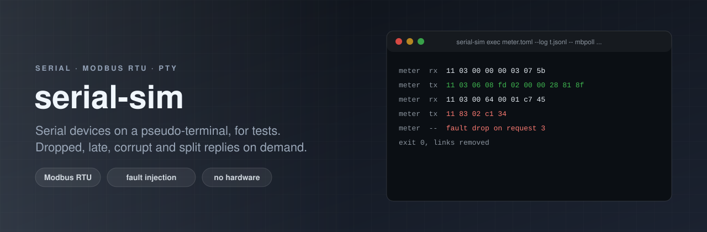

<p align="center"></p>

# serial-sim

[](https://github.com/ErenOzgu/serial-sim/actions/workflows/ci.yml)


**Serial devices for tests that have no hardware.** serial-sim creates pseudo-terminals that look like serial ports
(`/dev/pts/N`, reached through a link you name) and puts a simulated device behind each: a Modbus RTU slave with
registers and coils, a console that logs in and answers commands, a GPS-style stream of lines, or a plain echo. The
software under test opens the port as it would open `/dev/ttyUSB0`. Faults are part of the scenario: replies that never
come, come late, arrive in pieces, carry a wrong checksum or an exception, always the same ones for the same seed.

It is a single Python package with no dependencies, for Linux. A scenario is a TOML file.

## Why

Code that talks to hardware over a serial line is rarely tested for what hardware does badly: a meter that skips every
fifth poll, a reply cut in two, a checksum that is wrong once in a hundred frames, a controller that answers "busy" for
a while. On the bench these things happen when they like. With a scenario file they happen on request, in CI, with the
same result every time, and with a transcript of every byte to look at when a test fails.

## Try it

```sh
pip install git+https://github.com/ErenOzgu/serial-sim
git clone https://github.com/ErenOzgu/serial-sim && cd serial-sim
sudo apt-get install mbpoll        # a Modbus master; anything that opens a serial port will do

serial-sim exec examples/demo/meter.toml --log wire.jsonl -- \
    sh -c 'mbpoll -m rtu -a 17 -b 9600 -P none -t 4 -r 1 -c 3 -1 "$SERIAL_SIM_METER"'
serial-sim show wire.jsonl
```

`exec` starts the devices, runs the command with the port of each device in `$SERIAL_SIM_<NAME>`, stops the devices and
exits with the command's status. `mbpoll` reads three holding registers of unit 17 and prints `[1]: 2301`, `[2]: 512`
and `[3]: 40`, the values in `examples/demo/meter.toml`. To keep the devices running for as long as you like, use
`serial-sim run examples/demo/meter.toml` and point your program at the path it prints.

## What it prints

Everything that crossed the wire is in the transcript (`--log`, one JSON object per line); `serial-sim show` makes it
readable. This one is made by `examples/demo/ask.py`, a small Modbus master written with the standard library only, and
the file is checked against a fresh run in CI:

<!-- include:examples/demo/transcript.txt -->
```
meter      rx  11 03 00 00 00 03 07 5b
meter      tx  11 03 06 08 fd 02 00 00 28 81 8f
meter      rx  11 06 00 02 00 63 6a b3
meter      tx  11 06 00 02 00 63 6a b3
meter      rx  11 03 00 02 00 01 27 5a
meter      tx  11 03 02 00 63 39 ae
meter      rx  11 04 00 00 00 01 33 5a
meter      tx  11 04 02 03 e8 78 4d
meter      rx  11 04 00 00 00 01 33 5a
meter      tx  11 04 02 03 e9 b9 8d
meter      rx  11 03 00 64 00 01 c7 45
meter      tx  11 83 02 c1 34
meter      rx  12 03 00 00 00 01 86 a9
meter      --  ignored a frame for unit 18
```

Reading it: the first request reads three registers and the reply carries 2301, 512 and 40. The next four lines write
99 to register 2 (the reply to a write is an echo of the request) and read it back. The two reads of input register 0
show 1000 and then 1001, because that block has `step = 1`. The read of address 100 gets `83 02`: function 3 with the
top bit set, exception 2, illegal data address. The last request is for unit 18, not this device, so there is no reply.

## Device kinds

**`modbus-rtu`** is one slave with one address. Its data are blocks of holding registers, input registers, coils and
discrete inputs; reads and writes work as the specification says, including the exceptions. Frames are found in the byte
stream by their length and checksum, so noise in front of a frame, a frame that arrives in pieces and a frame cut off
by a gap are all handled. Several blocks, read-only blocks and registers that count up on every read make the data
change the way a live device's data do.

**`script`** is a line-oriented dialogue: a greeting, states with prompts, and rules that match a line with a regular
expression and answer with text, bytes or several lines with delays between them. `examples/console.toml` is the serial
console of an embedded board, with a boot banner, a login, a shell and a `reboot` that prints its messages over time.

**`stream`** sends its lines at an interval, forever or once: a GPS receiver's sentences, a sensor that reports every
second. `examples/gps.toml` is one.

**`echo`** sends back what it receives. It is for checking a serial library and for trying the faults.

All kinds can have a `baud` (replies take as long as the characters would on the wire) and faults.

<!-- include:examples/demo/meter.toml -->
```toml
# An energy meter on a Modbus RTU line, address 17.
seed = 1

[[device]]
name = "meter"
kind = "modbus-rtu"
unit = 17
baud = 9600

[[device.block]]
table = "holding"        # register 0: volts x 10, 1: amps x 100, 2: set point (read/write)
address = 0
values = [2301, 512, 40]

[[device.block]]
table = "input"          # register 0 counts up by one every time it is read
address = 0
values = [1000]
step = 1

[[device.block]]
table = "coil"
address = 0
values = [true, false, false, true]
```

## Faults

A fault is a table in the device. It says what goes wrong and for which requests; a request is whatever the device
answers: a Modbus frame addressed to it, a line to a script device, a read from an echo device, a line of a stream.
Requests are counted from 1 for each device. `every = 3` hits requests 3, 6, 9; `after = 20, until = 25` hits 21 to
25; `probability = 0.1` hits about one in ten, drawn from a generator seeded by the scenario's `seed` and the device,
and only for requests that passed the other tests, so the same scenario and the same requests always break the same
way. Several faults can hit one request; the Modbus ones are applied first, then the others in file order, and a dropped
reply ends the chain.

<!-- faults:start -->
| Fault | Applies to | What the client sees | Its own keys |
| --- | --- | --- | --- |
| `drop` | every kind | No reply at all. | none |
| `delay` | every kind | The reply comes `ms` late. | `ms` |
| `corrupt` | every kind | `bits` bits of the reply are flipped. | `bits` |
| `garbage` | every kind | `count` noise bytes come before the reply. | `count` |
| `truncate` | every kind | Only the first `keep` bytes arrive. | `keep` |
| `split` | every kind | The reply arrives in two parts, `ms` apart, cut at `at`. | `ms`, `at` |
| `duplicate` | every kind | The reply arrives twice. | none |
| `corrupt-crc` | modbus-rtu | The reply is complete but its checksum is wrong. | none |
| `exception` | modbus-rtu | An exception reply with `code` instead of the answer. | `code` |
| `wrong-unit` | modbus-rtu | The reply carries another address. | `unit` |
<!-- faults:end -->

<!-- include:examples/flaky-meter.toml -->
```toml
# The same meter as examples/demo/meter.toml, on a bad line: every kind of thing that goes wrong on RS-485.
seed = 7

[[device]]
name = "meter"
kind = "modbus-rtu"
unit = 17
baud = 9600

[[device.block]]
table = "holding"
address = 0
values = [2301, 512, 40]

[[device.block]]
table = "input"
address = 0
values = [1000]
step = 1

[[device.fault]]            # every 5th request gets no answer
kind = "drop"
every = 5

[[device.fault]]            # one request in ten comes back with a wrong checksum
kind = "corrupt-crc"
probability = 0.1

[[device.fault]]            # a slow device: the reply of every 4th request is 400 ms late
kind = "delay"
ms = 400
every = 4

[[device.fault]]            # requests 21 to 25 are answered "slave device busy"
kind = "exception"
code = 6
after = 20
until = 25

[[device.fault]]            # a reply that arrives in two pieces
kind = "split"
ms = 30
probability = 0.1
```

## Scenario reference

<details>
<summary>Every key a scenario file accepts (printed by <code>serial-sim reference</code>)</summary>

<!-- reference:start -->
#### top level

| Key | Type | Default | Meaning |
| --- | --- | --- | --- |
| `seed` | int | `0` | Seed of the random choices (probabilities, flipped bits, noise). Same seed, same run. |
| `device` | array of tables |  | The devices: one `[[device]]` table each. At least one. |

#### [[device]], every kind

| Key | Type | Default | Meaning |
| --- | --- | --- | --- |
| `name` | string | **required** | Letters, digits, `_` and `-`, starting with a letter, at most 32. Unique. |
| `kind` | string | **required** | `modbus-rtu`, `script`, `stream` or `echo`. |
| `link` | string | `a temporary directory` | Path of the symbolic link that points at the device node. Created at start, removed at exit. |
| `baud` | int | `0` | Replies take `length * char_bits / baud` seconds to arrive. 0 means no delay. |
| `char_bits` | int | `10` | Bits per character on the wire: start + 8 data + stop = 10; with parity, 11. |
| `bytewise` | bool | `false` | Needs `baud`. Send a reply one character at a time, each when it would have left the line, instead of as one piece when the last one has. For software with a time limit between characters. |
| `jitter_ms` | number | `0` | Each reply waits a random extra time from 0 up to this many milliseconds before it starts, drawn from the seeded generator of the device (the same seed gives the same delays). Greetings, prompts and echoed characters are not delayed. 0 to 60000. |
| `fault` | array of tables |  | Fault injection rules, applied to replies. See the fault table. |

#### [[device]] kind = "modbus-rtu"

| Key | Type | Default | Meaning |
| --- | --- | --- | --- |
| `unit` | int | **required** | Slave address, 1 to 247. Frames for other addresses are ignored; address 0 (broadcast) is obeyed for writes and never answered. |
| `frame_gap_ms` | number | `50` | Silence that ends a frame. Bytes left over after it are discarded; a frame of an unknown function is only answered after it. |
| `strict_addresses` | bool | `true` | An address outside every block is exception 2 (illegal data address). With `false` every address exists and starts at 0. |
| `block` | array of tables |  | The data. See the block table. |

#### [[device.block]]

| Key | Type | Default | Meaning |
| --- | --- | --- | --- |
| `table` | string | **required** | `holding`, `input` (16-bit registers), `coil` or `discrete` (single bits). |
| `address` | int | **required** | First address, 0 to 65535. |
| `values` | array | **required** | One entry per address: 0 to 65535 for registers; 0, 1, `true` or `false` for bits. |
| `writable` | bool | `true` | Holding registers and coils only. A write to a block with `false` is exception 2. |
| `step` | int | `0` | Registers only. After every successful read of the block, each value goes up by this much (modulo 65536). |

#### [[device]] kind = "script"

| Key | Type | Default | Meaning |
| --- | --- | --- | --- |
| `greeting` | string |  | Sent once at start. It waits in the device buffer until a client reads it. |
| `initial` | string |  | The state the dialogue starts in. Its prompt, if any, follows the greeting. |
| `prompts` | table of strings | `{}` | State name to prompt text. After every reply the prompt of the new state is sent. |
| `eol` | string | `"\r\n"` | Appended to each line of a `lines` reply. |
| `echo` | bool | `false` | Echo every received character back, like a console does. |
| `default_send` | string |  | Reply to a line that no rule matches. |
| `rule` | array of tables |  | What to answer. See the rule table. |

#### [[device.rule]]

| Key | Type | Default | Meaning |
| --- | --- | --- | --- |
| `match` | string | **required** | Regular expression, searched in the received line (without its terminator). The first rule that fits wins. |
| `state` | string | `any state` | The rule only applies in this state. |
| `send` | string |  | Reply text. `${line}` is the whole line, `${1}`, `${2}` ... are the groups of `match`. |
| `send_hex` | string |  | Reply bytes, as hex digits, for binary replies. Not together with `send` or `lines`. |
| `lines` | array of strings |  | Reply as several lines, each followed by `eol` and `line_delay_ms` apart (a boot log, say). |
| `line_delay_ms` | number | `0` | Pause between the lines of `lines`. |
| `delay_ms` | number | `0` | Pause before the reply. |
| `next` | string |  | The state after this rule. |
| `once` | bool | `false` | Use the rule once, then ignore it. |

#### [[device]] kind = "stream"

| Key | Type | Default | Meaning |
| --- | --- | --- | --- |
| `lines` | array of strings | **required** | What the device sends, one line per tick, in order. |
| `interval_ms` | number | **required** | Time between lines. |
| `loop` | bool | `true` | Start again after the last line. With `false` the stream ends. |
| `start_after_ms` | number | `0` | Wait before the first line. |
| `eol` | string | `"\r\n"` | Appended to each line. |

#### [[device.fault]]

| Key | Type | Default | Meaning |
| --- | --- | --- | --- |
| `kind` | string | **required** | What goes wrong. See the fault table. |
| `every` | int |  | Apply to every n-th request (the 1st request is number 1). |
| `probability` | number |  | Apply with this probability, 0 to 1, drawn from the seeded generator. |
| `after` | int | `0` | Only requests after this number. |
| `until` | int |  | Only requests up to this number (a burst, or an outage window). |
| `functions` | array of ints |  | Modbus only: apply only to requests with these function codes. |
| `ms` | number |  | `delay` and `split`: milliseconds. Required for `delay`. |
| `count` | int | `3` | `garbage`: number of noise bytes. |
| `keep` | int | `half` | `truncate`: number of bytes kept. |
| `at` | int | `half` | `split`: the byte where the reply is cut in two. |
| `bits` | int | `1` | `corrupt`: number of bits flipped. |
| `code` | int |  | `exception`: the Modbus exception code, 1 to 255. Required for `exception`. |
| `unit` | int |  | `wrong-unit`: the address the reply claims to come from, 0 to 255. Required for `wrong-unit`. |
<!-- reference:end -->

</details>

Unknown keys are errors, with a suggestion for the one you probably meant; so are values out of range, overlapping
blocks, a `next` state that does not exist, a regular expression that does not compile, a fault that does not apply to
the device kind, two devices whose names would give the same environment variable, and a file that is not UTF-8 or is
larger than 1 MiB.

### Modbus functions

<!-- functions:start -->
| Code | Function |
| --- | --- |
| 1 | Read Coils |
| 2 | Read Discrete Inputs |
| 3 | Read Holding Registers |
| 4 | Read Input Registers |
| 5 | Write Single Coil |
| 6 | Write Single Register |
| 15 | Write Multiple Coils |
| 16 | Write Multiple Registers |

| Exception | Name | When |
| --- | --- | --- |
| 1 | Illegal function | Any other function code (recognised or not). |
| 2 | Illegal data address | An address outside every block, or a write to a read-only block. |
| 3 | Illegal data value | A quantity out of range, a wrong byte count, a coil value other than 0x0000 or 0xFF00. |
<!-- functions:end -->

Other codes are answered with exception 1. Codes 7, 8, 11, 12, 17, 22 and 23 are recognised so that the frame is
measured correctly; any other code is only answered after `frame_gap_ms` of silence, because its length is unknown.

## Commands

| Command | What it does |
| --- | --- |
| `serial-sim run SCENARIO` | Starts the devices and keeps them running until it gets SIGINT or SIGTERM (exit status 0), or until `--duration`. |
| `serial-sim exec SCENARIO -- COMMAND [ARG...]` | Starts the devices, runs the command, stops the devices, exits with the command's status. |
| `serial-sim validate SCENARIO` | Checks the file and says what it describes. |
| `serial-sim show LOG` | Prints a transcript for people. |
| `serial-sim reference [scenario\|faults\|functions]` | Prints the reference above as Markdown. |

| Option | For | Meaning |
| --- | --- | --- |
| `--link NAME=PATH` | run, exec | Use PATH as the link of device NAME, instead of the one in the scenario. Repeatable. |
| `--dir DIR` | run, exec | Where the links of devices without a `link` go. Without it, a new directory under the temporary directory, removed at exit. |
| `--log FILE` | run, exec | Write the transcript. |
| `--duration SECONDS` | run | Stop by itself after this long. |
| `--ready-file FILE` | run | Write a JSON file with the pid and the link of every device once they exist, and remove it at exit. |
| `-q`, `--quiet` | run | Do not print the table of devices. |
| `--version` | `serial-sim` | Print the version and exit. |
| `--device NAME` | show | Only this device. |
| `--no-time` | show | Leave out the timestamps, to compare two runs. |
| `--text` | show | Also show the bytes as text. |

| Exit status | Meaning |
| --- | --- |
| 0 | `run` was stopped or reached its duration; `validate`, `show` and `reference` succeeded; for `exec`, the command's own status. |
| 2 | Usage error or a scenario file that cannot be used. The message says where and why. |
| 3 | The environment: no pseudo-terminals, a link that cannot be created or would replace a file that is not a symbolic link, a log or ready file that cannot be written. |
| 4 | `exec`: the simulator itself failed while the command ran, whatever the command's status was. |
| 127 | `exec`: the command could not be started. |
| 128 + n | `exec`: the command was killed by signal n. |

Environment of the command in `exec`: `SERIAL_SIM_<NAME>` is the path of each device (the name in capitals, other
characters as `_`) and `SERIAL_SIM_DEVICES` is a JSON object of all of them. Device names that would give
`SERIAL_SIM_DEVICES` or `SERIAL_SIM_REQUIRE_TOOLS` (which this repository's tests use) are refused.

## In your own tests

With `exec`, the whole test run happens inside the simulator's lifetime: `serial-sim exec scenario.toml -- pytest`.
With `run --ready-file`, a pytest fixture can keep the devices for a session:

<!-- include:examples/pytest/conftest.py -->
```python
"""A pytest fixture that runs serial-sim for the length of a test session and hands out the port path."""

import json
import subprocess
import sys
import time
from pathlib import Path

import pytest

SCENARIO = Path(__file__).resolve().parent.parent / "demo" / "meter.toml"


@pytest.fixture(scope="session")
def meter_port(tmp_path_factory):
    ready = tmp_path_factory.mktemp("serial-sim") / "ready.json"
    proc = subprocess.Popen(
        [sys.executable, "-m", "serial_sim", "run", str(SCENARIO), "--ready-file", str(ready), "-q"]
    )
    try:
        for _ in range(200):  # the file appears once every device exists
            if ready.exists():
                break
            if proc.poll() is not None:
                raise RuntimeError(f"serial-sim exited with status {proc.returncode}")
            time.sleep(0.05)
        else:
            raise RuntimeError("serial-sim did not start within 10 seconds")
        yield json.loads(ready.read_text())["devices"]["meter"]
    finally:
        proc.terminate()
        proc.wait(timeout=10)
```

`examples/pytest/` is a complete example, and the repository's own tests run it. A pull request check for a repository
that has serial code, `examples/ci/serial-tests.yml`, runs the tests against a scenario and prints the transcript when
they fail.

## How it is tested

- **Against the specification.** The worked examples of the Modbus Application Protocol specification (read coils,
  discrete inputs, holding and input registers, write single coil and register, write multiple coils and registers) are
  tests, and so are the exceptions, the limits of every quantity and address, and the framing. The checksum is tested
  against published vectors and against pymodbus on random data.
- **Against other people's software.** [pymodbus](https://github.com/pymodbus-dev/pymodbus), `mbpoll` (a master built on
  libmodbus) and [pyserial](https://github.com/pyserial/pyserial) talk to the simulated devices: every function, the
  exceptions, writes read back, a master that retries through dropped replies, one that must refuse a wrong checksum, a
  truncated reply or a reply from another address, a delayed reply, a reply in two parts, and a console driven through
  pyserial. If the frames were wrong, these would fail where tests written by the same hand would not. In CI the tools are
  installed and a test that needs one may not be skipped.
- **On real pseudo-terminals.** Timing (baud rate, delays, stream intervals, splits), faults, greetings that wait for a
  first reader, a client that closes and reopens the port, two devices at once, a client that never reads, and the
  lifecycle of the links: removed at exit, a stale link replaced, a regular file never replaced, nothing left behind
  after a failure halfway. The same seed breaks the same way and another seed does not.
- **Noise.** Random bytes into the Modbus parser (it must never fail and every reply must be a well-formed frame),
  random input into script devices, and a hundred and fifty mutated scenario files that may only produce a scenario or
  a `ScenarioError`.
- **The command line**, in subprocesses: signals, exit statuses, the environment of the command, options after `--`,
  every refusal.
- **The documentation.** The tables above are generated from the code that checks scenarios, the options and exit
  statuses are compared with the parser, every example scenario is validated, the transcript above is compared with a
  fresh run in CI, and the pytest and workflow examples are the files that are run and linted.
- **Mutation check, done once by hand.** A script applied 184 small mutations to a copy of the sources (a comparison
  flipped, a boundary moved by one, a condition removed, two bytes swapped, a fault applied in the wrong order) and ran
  the whole suite against each. 22 survived the first pass: the largest legal write, a write reaching into a read-only
  block, what a client that does not read loses, validation of transcript files and a few more. Each got a test and all
  184 are now caught. The script is not in the repository and not part of CI, so this describes the day it was run, not
  a guarantee about later changes.
- **Where.** GitHub's Ubuntu 22.04, 24.04 and 24.04 on arm64 runners, and Python 3.11, 3.12 and 3.13. The wheel is built,
  installed into a clean environment and used from another directory with `mbpoll`.

## What it cannot do

- **A pseudo-terminal is not a UART.** The line settings a client chooses (baud rate, parity, stop bits) are accepted
  and ignored. Framing, parity and overrun errors, break, and the modem control lines (RTS, CTS, DTR) do not exist, and
  neither does the direction control of RS-485 or a transceiver that hears its own transmission.
- **Timing is approximate.** With `baud` set, a reply is delivered as one piece when its last character would have left
  the line; the characters do not arrive one by one unless the device says `bytewise = true`, which sends each
  character when it would have left the line (and gives each its own transcript record). Real devices also vary in how
  long they take to answer; `jitter_ms = 50` adds a random extra wait of 0 to 50 ms to each reply, the same
  sequence for the same seed. A request is seen as the client wrote it, so the gap of 3.5
  characters that ends a Modbus RTU frame is replaced by `frame_gap_ms`. Timing comes from a Python loop on an ordinary
  Linux machine: a reply is never early and is late by whatever the scheduler adds, normally milliseconds, more on a
  busy machine. It is not a real-time system: it is for testing software against slow and late devices, not
  for measuring turnaround times.
- **One device is one address.** A bus with several slaves on one port is not simulated; give each its own link.
- **Modbus RTU slave only.** No master, no Modbus ASCII, no TCP. Only exceptions 1 to 3 arise on their own; others come
  from the `exception` fault. There is no model of what a register means, only the data you give it and `step`.
- **Scripts are lines and regular expressions.** Input is matched as Latin-1 text, a line longer than 4096 bytes is cut,
  echo understands backspace and nothing else (no cursor keys or history), and replies are fixed text with `${1}`-style
  groups, not a program. Regular expressions come from the scenario file and are not sandboxed: a pathological one can
  stall the loop, so scenario files are trusted input.
- **Streams are time-driven.** A stream sends on its own clock, whatever the client does; it does not wait to be polled.
- **A client that does not read** gets what fits in the kernel's buffer of the port and then up to 64 KiB held by the
  simulator; beyond that bytes are dropped and the transcript says so.
- **Greetings are sent when the devices start,** not when a client opens the port. They wait in the buffer, so a client
  that opens later reads them (pyserial 3.5 on Linux does), but one that flushes its input when it opens the port does
  not.
- **The transcript is the simulator's view.** A read can hold several writes of the client or part of one, and the time is
  when the simulator read or wrote, not when anything was on a wire.
- **Only Linux was tried.** macOS has pseudo-terminals and may work; Windows has none. Only pymodbus, mbpoll and pyserial
  were tried as clients; not minicom, picocom, screen or any PLC or SCADA software.
- **One thread serves all devices.** Many busy devices share a loop.

## Layout

```
serial_sim/    scenario.py (the file format and its checks), modbus.py, behaviours.py (script, stream, echo),
               faults.py, engine.py (the loop), link.py (the pseudo-terminal), transcript.py, docs.py, cli.py
tests/         unit tests, pty tests, tests against pymodbus, mbpoll and pyserial, command line tests
examples/      demo/ (the meter and the master behind the transcript), console.toml, flaky-meter.toml, gps.toml,
               pytest/ (a fixture), ci/ (a pull request workflow)
```

## More

[Design notes](docs/design-notes.md) (why it is built this way, what was rejected, how it was checked),
[CHANGELOG](CHANGELOG.md) and [ROADMAP](ROADMAP.md).

## License

MIT, see [LICENSE](LICENSE).
